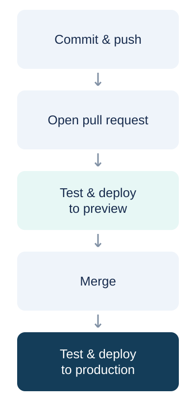

# Launchpad · Web app delivery demo

A small, working release dashboard demonstrating the path from a pull request to a live deployment.

**[Live production app](https://shadamik.github.io/web-app-delivery-demo/)** · **[GitHub Actions](https://github.com/shadamik/web-app-delivery-demo/actions)**

## Delivery workflow

1. Commit and push a small change on a branch.
2. Open a pull request against `main`.
3. **Test → Deploy to preview** publishes the tested app at `/preview/pr-N/`.
4. Merge the pull request.
5. **Test → Deploy to production** publishes the merged app at the site root.

Both workflows run real Node.js tests, build the app, deploy it using GitHub Pages, and check that the live deployment identifies the expected commit. Failed tests prevent deployment. There are no external hosting credentials or paid services.



## Local development

Requires Node.js 22 or later. No package installation is needed.

```sh
npm test
npm run build
python3 -m http.server 8080 --directory dist
```

## Demo boundaries

The release cards and metrics are illustrative product data, clearly labeled in the app. They are not GitHub Actions test results. The GitHub Actions runs and deployments themselves are real.

This public demo uses one GitHub Pages site: production at the root, previews in separate subdirectories. Deployments are serialized and the `site-state` branch retains the published files so a preview does not replace production. Preview publishing is limited to same-repository pull requests initiated by the repository owner; other pull requests run read-only tests only. Preview URLs are retained after merge for presentation purposes. This is a demonstration setup, not a production isolation architecture.

For a presentation, open the preview workflow's graph, the merged pull request, and the production workflow's graph. Each successful graph shows **Test → Deploy** with green statuses and a link to the deployed environment.
